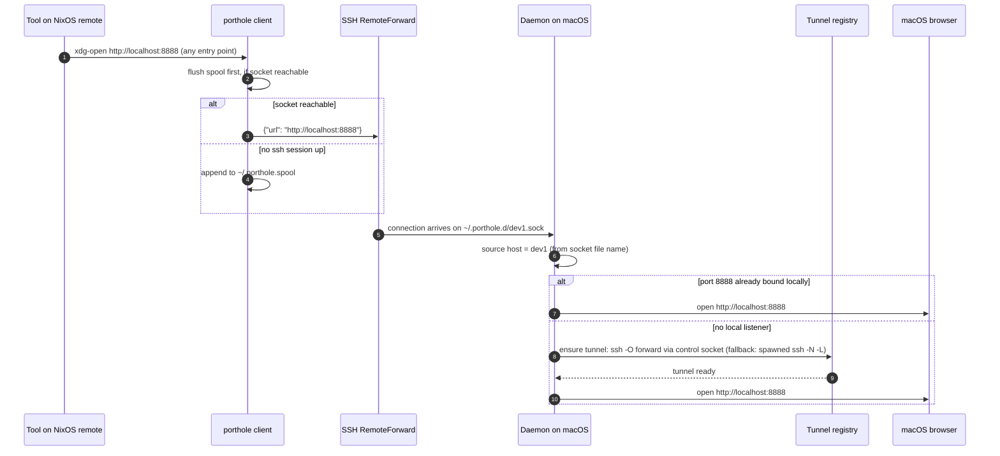
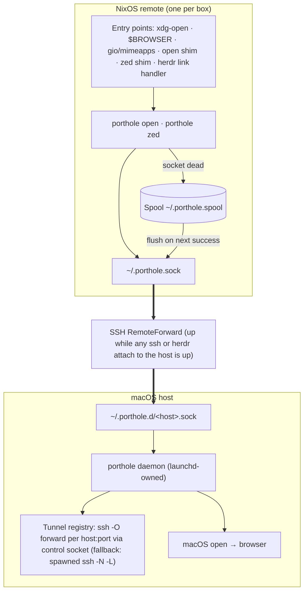

# porthole — Architecture

Status: built and smoke-tested. Name: `porthole`. The CLI installs as `porthole` with a `ph` symlink.

Primary targets: macOS as the local host, NixOS as the remote OS. Everything else is secondary.

## 1. Purpose

porthole opens URLs from remote machines in the local macOS browser. A tool on a NixOS remote calls `xdg-open <url>` or any equivalent entry point. The URL arrives in the default macOS browser.

If the URL targets a loopback port on the remote, the system first creates an SSH tunnel for that port. The browser then reaches the remote service through the tunnel. The user does nothing.

OAuth flows get the same treatment from the other direction. The authorize URL carries the loopback callback in its query (`redirect_uri` and friends), and the browser is redirected there without porthole ever seeing that URL. The daemon sniffs the callback port out of every opened URL's query parameters and pre-tunnels it, so the IdP's redirect back to localhost lands on a live tunnel.

## 2. Design rules

- Nix manages every component on both sides. Owned machines get no imperative install steps.
- The remote runs no daemon. The remote side is a stateless client plus a spool file.
- SSH owns the transport. herdr owns nothing in the critical path.
- One binary serves every role: daemon, client, and admin tool. Roles are feature-gated, not target-gated: the daemon code is unix-portable but irrelevant on remotes, so the `daemon` cargo feature (default on) gates daemon/status/tunnel and the tokio dependency. The remote build uses `--no-default-features`, ships only `open`, and never compiles tokio. `open` stays in both builds — on macOS it doubles as the daemon's local test harness.

## 3. Components

### 3.1 macOS host

**Daemon.** Listens on one Unix socket per remote host under `~/.porthole.d/`. Validates URLs and paths. Manages tunnels. Calls `open`. A launchd agent owns the process and restarts it after a crash.

**Connection supervisor.** The daemon owns a persistent `ssh -N -M` master per host on a dedicated control socket at `~/.porthole.d/master/<host>`. This master carries the RemoteForward (request delivery from the remote) and serves as the control socket for on-demand `-L` tunnel forwards. When the connection dies — laptop sleep, network loss — a supervisor task respawns it with exponential backoff (1s → 30s). The daemon never depends on externally-managed SSH sessions (herdr, Zed, terminals); those keep their own multiplexing on a separate ControlPath (`~/.porthole.d/control/%n`) and do not interfere. On startup, any master left behind by a previous daemon (crash, kill -9) is stopped via `ssh -O exit` before the new one spawns.

**Socket directory.** `~/.porthole.d/<host>.sock`. The socket file name identifies the source host. This solves multi-host attribution without metadata or mapping tables.

**Tunnel registry.** Tracks one ssh port forward per host and port. Two mechanisms, one policy. When the supervisor's master is alive — the control socket at `~/.porthole.d/master/<host>` is probed with a connect, and a stale file (nobody listening) is unlinked before use — a forward is one synchronous `ssh -S <sock> -O forward -L <port>:localhost:<port>` round trip to the live master. Nothing to spawn or supervise, and forwards die with the connection, which is the right lifetime. When the master is down (reconnecting) or absent, a spawned `ssh -N -L` child provides the forward instead, reaped on exit. Tunnels live for the connection (mux) or the daemon lifetime (child).

**Callback reaper.** Forwards created by the OAuth sniff get a lifecycle; forwards from a URL's own loopback host (dev servers) do not. A daemon task polls each sniffed forward: a connection riding it is visible as an lsof ESTABLISHED socket whose local side is the forwarded port — the daemon's own readiness probes appear with the port on their remote side and never count as use. A forward that carried a connection and has been quiet for 5 minutes, or that no connection ever rode and no request touched for 30 minutes (an abandoned flow — also the MFA patience window), is canceled (`ssh -O cancel` for mux, the cancel flag for children) and its entry dropped. This exists because OAuth callback ports are fixed (AWS SSO): a sniffed forward squatting one for days blocks local tools from ever binding it. A direct URL request promotes a sniffed entry to a dev entry and stops reaping it.

**CLI.** The same binary. Subcommands: `daemon`, `open`, `status`, `tunnel`. The nix module installs the binary as `porthole` plus a `ph` symlink for typing.

**SSH configuration.** home-manager `programs.ssh.settings` declares multiplexing settings (`ControlMaster auto`, `ControlPath ~/.porthole.d/control/%n`, `ControlPersist 60m`) for interactive sessions. The RemoteForward is owned by the daemon's supervisor, not the ssh config — an interactive-session RemoteForward would clobber the supervisor's on the remote socket (`StreamLocalBindUnlink` replaces it on each new connection).

**herdr plugin.** A thin manifest in the same repo. Optional at runtime. See section 5.

### 3.2 NixOS remote

**Client.** The `open` subcommand. It writes one JSON line to `~/.porthole.sock`. If the socket is absent or refused, it appends to `~/.porthole.spool`. Each invocation flushes the spool first when the socket accepts connections.

**Zed shim.** The home-manager module links `zed` to the client (on by default; `zedShim = false` disables it). The shim resolves one path to an absolute remote path and sends `{"zed":{"path":...,"user":...}}`. The daemon takes the host alias from the socket name and builds `ssh://<user>@<host>/<path>`, then runs the local Zed CLI. The URL matches the user's existing ssh config because the alias is the same one porthole already uses. Zed requests get a reply and are never spooled: a stale `zed .` must not steal focus later. The CLI path is probed in the app bundle and PATH; `PORTHOLE_ZED` overrides it.

**Path opens.** The same `open` shim that carries URLs also accepts a file path. It resolves `~` and relative paths the way the Zed shim does, then sends `{"path":...}`. The daemon requires an absolute path without control characters. The same path must also exist on the Mac. The user syncs the trees and porthole transfers nothing. When the path exists, the daemon runs the opener on it. Otherwise it replies with the reason and the remote prints it.

Path requests get a reply and are never spooled. A stale open would steal focus hours later, which is why Zed requests are not spooled either. The trust is the same as the URL verb: a remote can open any file that already exists locally, including app bundles.

**Browser registration.** Fully declarative through home-manager. `xdg.desktopEntries` provides `porthole.desktop`. `xdg.mimeApps.defaultApplications` binds `x-scheme-handler/http` and `x-scheme-handler/https`. `home.sessionVariables.BROWSER` covers stock `xdg-open` and every tool that reads `$BROWSER`. A small `open` shim covers macOS-style calls. `home.sessionVariables.DISPLAY` spoofs a display for launchers that gate on one (gcloud's `check_browser.py` requires `DISPLAY`, `WAYLAND_DISPLAY`, or `MIR_SOCKET` and never reads `$BROWSER`). Debian alternatives do not apply on NixOS.

**sshd hygiene.** `services.openssh.settings.StreamLocalBindUnlink = true` lets sshd replace a stale remote socket on reconnect.

### 3.3 What herdr contributes

The plugin provides a link handler and actions. A Ctrl+click on a loopback URL in a herdr pane routes to `porthole open` instead of a direct browser open. This fixes the dead-browser-tab case when no tunnel exists yet.

During a `herdr --remote` attach, the link handler action runs on the remote server. It writes to the same forwarded socket. The attach itself guarantees that the socket is alive at that moment.

Herdr provides no transport, no process supervision, and no plugin-side daemon.

## 4. The path of a URL

## 5. Component map

## 6. Multi-host model

Each remote forwards to its own local socket path. The daemon learns the source host from the socket file name. There are no hostname mapping tables and no trusted payload fields.

Two remotes can serve the same loopback port at the same time. The first tunnel wins the local port. A later request for the same local port from a different host fails with a clear error. A later version can add explicit local-port remapping. The daemon then rewrites the URL before `open`.

## 7. Ownership

| Layer | Owner | Mechanism |
|---|---|---|
| Binary, both sides | nix | Package in the system flake |
| Daemon lifecycle | launchd | home-manager `launchd.agents`, KeepAlive |
| SSH transport | daemon supervisor | `ssh -N -M` per host, `~/.porthole.d/master/<host>` |
| Remote socket hygiene | NixOS | `services.openssh.settings.StreamLocalBindUnlink` |
| Browser registration | home-manager on NixOS | `xdg.mimeApps`, `xdg.desktopEntries`, `sessionVariables.BROWSER` |
| Zed shim | home-manager on NixOS | `zed` symlink to the client (default on) |
| Local Zed launch | daemon | Probed app bundle/PATH, `PORTHOLE_ZED` override |
| Click routing in TUI | herdr | Plugin link handler, linked by a home-manager activation |

## 8. Failure modes

- **No ssh session to the remote.** The supervisor's master is down (reconnecting). The remote socket is dead. The client appends to the spool. The supervisor reconnects within seconds of the network returning; the next successful call flushes the spool. URLs from detached agents arrive late, not never.
- **Daemon restart.** The supervisor stops all masters (`ssh -O exit`) on shutdown. On restart, it re-establishes them from scratch. Mux forwards from the previous master are gone; the next URL recreates them on demand. Spawned child tunnels die with the daemon; the next URL recreates them on demand.
- **Stale callback forward squatting a fixed loopback port.** OAuth callback ports are fixed, so a sniffed forward from days ago can block a local tool (AWS SSO on the Mac) from ever binding its own callback port. The callback reaper tears the forward down once its flow's redirect has ridden it and gone quiet (5 min), or when no connection ever lands (30 min). While it squats, it also poisons the local-wins policy for remote requests to the same port — same root cause, same fix.
- **Laptop sleep / network loss.** The TCP connection dies. The ssh master detects the close and exits (immediately on TCP RST/FIN, or within 30s via ServerAliveInterval for half-open connections). The supervisor detects the exit and respawns with backoff. When the network returns, the supervisor reconnects, the RemoteForward comes back, and spooled URLs flush on the next call. Tunnels are on-demand: the next `porthole open localhost:PORT` recreates them via the new master.
- **Stale remote socket after a dropped connection.** `StreamLocalBindUnlink` replaces it on the next connect.
- **Stale local control socket.** The daemon probes every control socket with a connect before use; a stale file (nobody listening) is unlinked so it never clogs the mux path or child tunnels with "ControlSocket already exists."
- **Local port already bound by an unrelated local process.** Local wins. The daemon opens the URL without a tunnel and logs the decision. Explicit remapping is the escape hatch.
- **Callback URLs the sniff cannot see.** SAML CLI flows hide the ACS URL inside the base64 SAMLRequest blob; oauth-proxy interstitials double-encode it. Those flows break at the redirect. If one bites, the fix is an explicit `porthole forward <port>` verb on the remote — a one-line protocol addition, deliberately not built yet.
- **Local Zed missing or outside the probed paths.** The `zed` shim gets the daemon's error reply instead of a silent no-op. Set `programs.porthole.zedCommand` on the Mac or `PORTHOLE_ZED` in the daemon environment.
- **A remote path with no local counterpart.** The daemon replies with `'<path>' does not exist on this Mac` and the remote prints it. Nothing is fetched and nothing is spooled, so the failure lands on the machine that asked.
- **herdr not installed.** Everything except click routing still works.

## 9. What we build

1. The `porthole` binary: daemon, client, and admin roles. Language is an open decision.
2. A nix package plus two modules: a darwin/home-manager module and a NixOS-remote home-manager module.
3. The herdr plugin manifest in the same repo.
4. An `install-remote` subcommand for non-nix remotes. Secondary target.
5. Documentation.

## 10. Non-goals for v1

Scope notes, not doctrine — most of these fall when they itch. Two are load-bearing: the http/https-only rule is a safety boundary (the daemon hands the string to `open(1)`), and "no daemon on remotes" is what makes the spool design exist.

- No daemon on remotes.
- No supervision through herdr startup hooks.
- No idle reaping of dev-server tunnels. Sniffed callback forwards are reaped after their one redirect (2026-09-11); see the callback reaper in 3.1.
- No Linux or Windows local host. No WSL.
- Only `http` and `https` URLs pass URL validation. A path is a separate request: it never spools and the daemon opens it only if the same path exists locally.

## 11. Open decisions

- Implementation language: decided (2026-08-16). Rust, single-threaded tokio (`new_current_thread`; `rt-multi-thread` not compiled in). Hand-rolled CLI parsing, no clap. No tracing/anyhow until structure earns it.
- Tunnel idle and teardown policy: decided for the sniffed class (2026-09-11). Callback forwards are reaped use-aware — connection-seen-then-quiet (5 min) or never-used (30 min) — with the lsof local-side filter so the daemon's own probes never count as use. This replaces the rejected 60s from-creation TTL, which killed flows mid-MFA; a use-aware clock never fires before the redirect's first connection. Dev forwards stay unreaped: their use is open-ended, and every `porthole open` recreates on demand. Still open: conflict eviction for dev forwards (a stale dev forward from host A blocking host B on the same port until the connection dies).
- Multiplexed tunnel architecture: considered and rejected (2026-08-17). A single porthole-to-porthole mux per host (own both sockets, real observability) breaks the load-bearing rule — no daemon on remotes — and replaces the zero-code ssh tunnel layer with a hand-rolled wire protocol (framing, flow control, versioning). If true traffic observability ever matters, idle detection's composite signal (last_requested + lsof established check) is the cheap answer. This is the sshuttle shape: a good different project. The rejection's own escape hatch was adopted (2026-08-18): per-port forwards now go through ControlMaster + `ssh -O forward` on the supervisor's master control socket, with spawned `ssh -N -L` children as the fallback when the master is down. The supervisor owns a persistent `ssh -N -M` per host (added 2026-08-26), carrying the RemoteForward and providing the control socket. This replaced the earlier design where porthole relied on the user's interactive SSH sessions for both the RemoteForward and the control socket — that design broke on laptop sleep / network loss because nothing reconnected. The supervisor auto-reconnects with exponential backoff, making the daemon self-healing.
- Spool size limits and flush triggers past "next successful call". Includes staleness: the spool stays in $HOME because /run/user/$UID can vanish under detached agents (logind removes it at last logout without linger). If post-reboot delivery of dead loopback URLs ever bites, stamp spool lines with /proc/sys/kernel/random/boot_id and discard on mismatch — /run semantics without /run fragility. Also open: flush *timing* — "next successful call" delivers stale URLs at random mid-session moments; flushing on session establishment (ssh attach / login hook) arrives at the least surprising moment. And a TTL on flush, since the transport can't see intent: an SSO login link and a dev-server URL differ only in shelf life, and TTL approximates shelf life.
